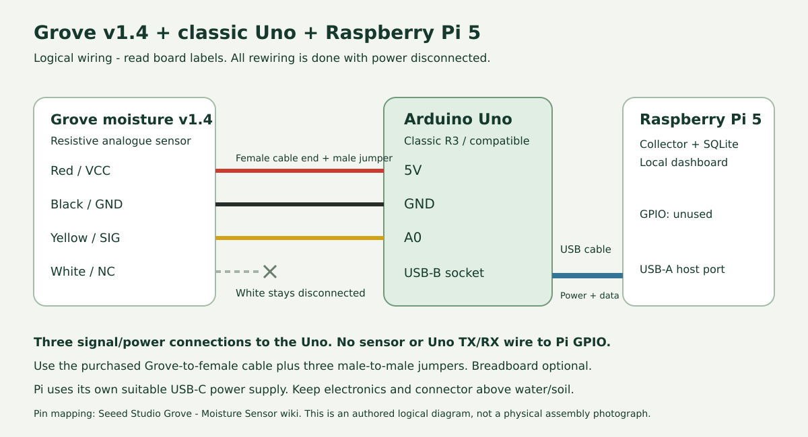

# Hardware and technology choices

## Equipment

| Item | Role and reason for use |
| --- | --- |
| Grove Moisture Sensor v1.4 | An analogue resistive probe that responds to changes in the surrounding soil; the project establishes its own reference readings |
| Classic Arduino Uno | Reads the analogue signal through its 10-bit ADC, selects a median measurement and sends the result over USB |
| Raspberry Pi 5 with microSD | Runs Linux, collects and stores measurements, and serves the dashboard using its USB and networking interfaces |
| USB A-to-B cable | Carries Uno serial data to the Pi and supplies the Uno with power |
| Separate Pi USB-C supply | Powers the Pi and its connected equipment |
| Grove cable and jumper wires | Connect the probe's power, ground and analogue signal to the Uno; a breadboard can assist connections |
| Soil container and syringe | Provide a repeatable test setup and measured portions; the project used a 5 mL syringe with 0.5 mL graduations |
| Browser on a laptop or phone | Displays the local dashboard and produces the optional audible warning |

## Connections

Disconnect power while changing the wiring and use the labels on the board.

| Grove wire | Uno connection |
| --- | --- |
| Red / VCC | 5V |
| Black / GND | GND |
| Yellow / signal | A0 |
| White | Leave disconnected |

Connect the Uno's USB-B socket to a Pi USB-A host port. The Pi uses its own power supply. The sensor connects to the Uno; the Pi's GPIO pins are unused in this design.

This diagram gives the logical pin mapping. It is separate from the physical circuit illustration in the academic paper.

## Software choices

| Technology | Reason for use |
| --- | --- |
| Arduino C++ sketch | Direct analogue acquisition with fixed-size sampling and a small newline-delimited JSON message |
| USB serial and pySerial | A direct link between the Uno and Pi, with reconnect handling in the collector |
| Python | Connects serial acquisition, decision rules, empirical prediction and report calculations in one application |
| Flask and Waitress | Serve the dashboard and its HTTP endpoints from the Pi |
| SQLite | Stores readings, calibration references, trial captures, water entries, observations and events locally |
| HTML, CSS and JavaScript | Provide a browser interface with canvas graphs and optional Web Audio alerts |
| Local Wi-Fi | Lets another device access the Pi's dashboard without requiring a monitor attached to the Pi |

## Measurement meaning

The probe measures an electrical response in the soil. The application maps ADC readings between a dry reference and a drained wet reference onto a relative 0-100 scale. The index is not a measurement of leaf humidity or a calibrated volumetric water percentage.

Probe contact, soil composition, placement and settling affect the response. Match these conditions to the selected water profile when interpreting a quantity estimate.
